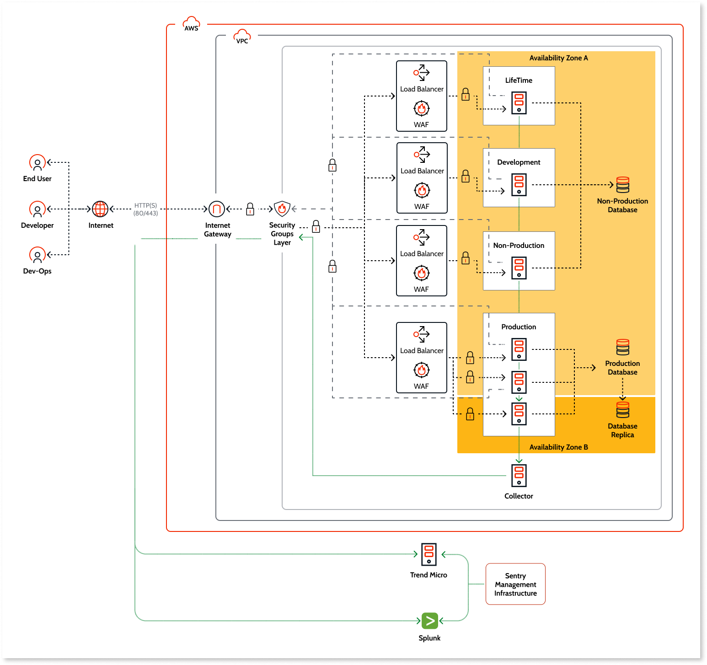

# Sentry for OutSystems 11

OutSystems 11 Sentry is an add-on that requires a subscription. To add Sentry, contact your OutSystems account manager.

OutSystems 11 Sentry is a security and compliance add-on for OutSystems 11 Cloud. If your organization needs extra layers of compliance and security monitoring, Sentry adds them to the [built-in security of the platform](intro.md). For the ODC equivalent, refer to [Sentry for ODC](https://www.outsystems.com/tk/redirect?g=0fb1e2f0-a05d-46c8-b70f-930add9672b8) in the ODC documentation.

## Capabilities

OutSystems 11 Sentry includes the following capabilities:

* **Compliance certifications**: Attestation and documentation for regulatory standards including [HIPAA](hipaa/intro.md), [PCI DSS](pci-compliance.md), and SOC 2. For the current list of certifications and attestations, refer to [OutSystems 11 Sentry security](https://security.outsystems.com/?product=o11sentry).

* **Security monitoring**: OutSystems collects and correlates the logs of your infrastructure in a security information and event management (SIEM) system to detect unauthorized changes, unauthorized access, and abnormal network activity. A dedicated security operations team monitors these events 24 hours a day, 7 days a week.

* **Intrusion detection and prevention**: Safeguards on the servers of your infrastructure protect your apps and data from known, unknown, and undisclosed threats. They block intrusion attempts and detect unauthorized changes to critical files, folders, processes, settings, and ports.

* **Malware protection**: Anti-malware software scans the servers of your infrastructure for malware, viruses, and ransomware.

* **Log retention**: Security and audit logs are retained for 1 year to support audits and forensic investigations. For more information, refer to [Securing data at rest with encryption](data-security-rest/data-security-rest.md).

* **Sentry Monitoring dashboard**: Review the security and audit events of your infrastructure in the Customer Portal, filter them by time period, and export them to Excel. For more information, refer to [Sentry monitoring dashboard](#sentry-dashboard).

## Sentry architecture

The following diagram shows the architecture of an OutSystems 11 Cloud infrastructure with the Sentry add-on. Infrastructures with Sentry also include the high-availability option.

For more information about the high-availability option, refer to [OutSystems Cloud network architecture](../setup-infra-platform/setup/possible-setups/cloud-architecture.md).

## Sentry monitoring dashboard {#sentry-dashboard}

If your infrastructure includes Sentry, the Sentry Monitoring dashboard provides you an overview of the security and audit events of your infrastructure. To confirm that Sentry is active for your infrastructure, check the **Subscription** page in the Customer Portal.

The dashboard shows events in the following areas:

* Infrastructure access, such as logins to the infrastructure, failed logins, OutSystems Support access, and direct database access.
* Platform access, such as brute force attack detection and login activity in LifeTime and Service Center, including suspicious logins.
* Platform security, such as anti-malware events, intrusion prevention events, and vulnerability scans.

The dashboard data refreshes once a day, usually between 00:00 and 06:00 UTC. OutSystems security operations contacts you directly if a security incident occurs.

### Access the Sentry dashboard

You need the Account Admin or Infra Admin role to access the dashboard. To open it, follow these steps:

1. In the [Customer Portal](https://www.outsystems.com/tk/redirect?g=5bd7f106-3784-4821-a603-0ad0c0fd8f82), go to **Platform**.
1. Select **Sentry Monitoring**.
